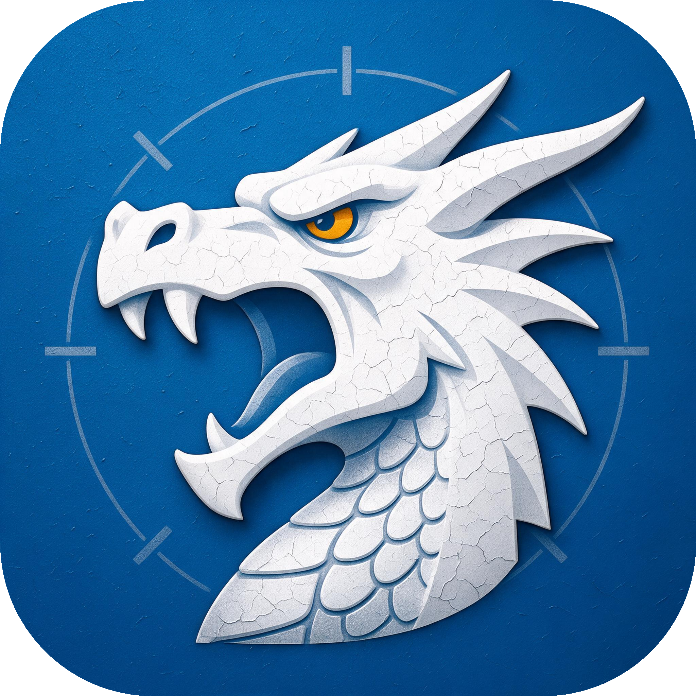

# DIS Weather Station

<p align="center">
  
  
  <br />
</p>

<p align="center">
  
</p>

<hr>

<p align="center">
  <a href="https://dragon-detector.vercel.app"></a>
</p>

<p align="center">
  
  
  
  
  
  
  
  
  
</p>

Live school weather station for **Dresden International School**, a Sainlogic
WS3500 on the campus roof, published as a fast, accessible dashboard for
students, teachers and families.

**Live:** https://dragon-detector.vercel.app

---

## The station

A Sainlogic WS3500 all-in-one sensor array (thermistor, capacitive humidity,
tipping-bucket rain, 3-cup anemometer, wind vane, piezoresistive barometer,
photodiode + UV) mounted on a rooftop mast ~14 m above ground at
51.0504° N, 13.7373° E (112 m elevation, Europe/Berlin). The console uploads
via 868 MHz RF to an Ecowitt Cloud gateway; this site reads the Ecowitt API
server-side (keys never reach the browser) and falls back to a deterministic
mock simulator with rain, storm, calm and offline scenarios for development.

Full hardware detail lives on the **Station** page and in
`docs/07_Station_Hardware_WS3500.md`.

## Pages

| Page | What you get |
|---|---|
| **Live** (`/`) | Bento-grid instrument tiles, temperature hero with editorial summary + jacket advice, wind compass, rain gauge, humidity, pressure with trend, UV, solar, sun & moon. Every tile links into the student guide. |
| **Coming up** (in hero) | 12-hour temperature curve + precipitation-probability bars from Open-Meteo model data fused with station readings, plus one plain-language sentence, AI-written via Groq when configured, station statistics otherwise. The sentence arrives in a second, cancellable request: the hero shows "Generating your AI outlook…" with a Stop button while the model works, and says so plainly (with Retry) when it cannot answer. One shared 15-minute server cache serves every visitor. |
| **Data** (`/data`) | 24h/7d history table and charts, metric/imperial toggle, CSV export (always metric). |
| **Learn** (`/learn`) | 12 measurement explainers in two reading levels (kids / students), classroom activities and a printable teacher handout. Activities are teacher-only; everyone else sees a note. |
| **Station** (`/station`) | Specs, siting geometry, sensor tolerances (unit-converted), maintenance records. |
| **Lobby display** (`/display`) | Chromeless fullscreen view for campus screens. |

Cross-cutting features:

- **Role onboarding**, first visit asks who you are (Kindergarten, PYP, MYP,
  DP, Teacher, Family). The choice persists locally, drives the Learn reading
  level, gates teacher content, and is changeable in the footer any time.
- **Metric/imperial everywhere**, station tolerances, Learn unit rows, the
  hero sentence and all tiles follow the toggle.
- **Theme-aware brand system**, DIS Blue in light mode, DIS Amber in dark
  mode, tabular numerals, 12px instrument tiles, no gradients or decorative
  cards (see `docs/03`).
- **Privacy-first**, no accounts needed for weather; roles and units live in
  `localStorage`, nothing tracking.

## Getting started

```bash
pnpm install
pnpm dev        # http://localhost:3000
```

```bash
pnpm build      # production build (required before calling work done)
pnpm lint       # ESLint, zero warnings expected
npx vitest run  # unit tests (engine, content, conversions, regressions)
```

### Environment

Copy `.env.example` to `.env.local` (gitignored, **never commit real keys**):

```bash
DATA_SOURCE=openmeteo     # openmeteo (default, no key) | mock | ecowitt (station)
MOCK_SCENARIO=default     # dev only: storm | calm | rain | offline

# Station link: switch DATA_SOURCE to ecowitt and fill all three in.
# Keys: ecowitt.net -> profile -> API management. MAC: WS View app device list.
ECOWITT_APPLICATION_KEY=
ECOWITT_API_KEY=
ECOWITT_MAC=

GROQ_API_KEY=             # optional: enables the AI outlook sentence
                          # (free tier; without it, statistics are used)
                          # Get one at https://console.groq.com

NEXT_PUBLIC_SUPABASE_URL=       # learning-track accounts (Google + email)
NEXT_PUBLIC_SUPABASE_ANON_KEY=  # publishable key: public-by-design, RLS enforced
```

Restart `pnpm dev` after editing `.env.local` — Next.js reads env only at boot.
If `DATA_SOURCE=ecowitt` but a credential is missing, `/api/weather` answers
503 and the server log names the missing var (never the values).

Keys are server-only: the browser talks to our `/api/*` routes, never to
Groq or Ecowitt directly. The Supabase publishable key is designed for
browser use and is protected by row-level security; real secrets stay in
`.env.local`.

## Project structure

```
src/app/              # App Router pages + API routes
                      # (/api/weather, /api/history, /api/outlook)
src/components/
  weather/            # instrument tiles, hero, outlook graph, skeletons
  learn/              # explainer cards, activities, teacher handout
  onboarding/         # role picker, role switcher
  ui/                 # selector listbox, tooltip (portal), buttons, cards
src/context/          # unit (metric/imperial), role, theme, effects
src/lib/              # units, summary + outlook engines, beaufort,
                      # sources (mock/ecowitt), content (concepts/activities)
src/hooks/            # useWeather (SWR data layer)
docs/                 # 00–11: brief, API model, design system, build spec,
                      # station hardware, education content, plans
scripts/screenshots/  # CDP capture helpers for visual verification
screenshots/          # local verification shots (gitignored, regenerable)
```

`docs/` is the source of truth, read `docs/00`–`docs/07` before changing
anything. Contributor house rules live in `AGENTS.md` (tests + build + lint
before done, minimal diffs, update `docs/PROGRESS.md`).

### Verification workflow

Deterministic mock scenarios plus headless-Chrome captures:

```bash
node scripts/screenshots/verify-docs11.mjs http://localhost:3000 .
```

Shots land in `screenshots/` (never committed). Dev panels stay hidden,
the scenario switcher appears only after pressing `D` three times.

## Share & embed

### Link previews show live conditions

`src/app/opengraph-image.tsx` renders a 1200x630 card from the live reading,
so a link shared in Slack, Teams, WhatsApp or on the school site shows the
actual temperature, feels-like, humidity and wind instead of a static logo.
The card names the real backend (`Ecowitt Cloud API · station WS3500`) and how
long ago the reading was taken, and falls back to a branded "Live data
unavailable" card if the API cannot be reached. Regenerated at most every two
minutes (`revalidate = 120`).

### Embedding the live card

`/embed` is a compact card that fills its iframe and refreshes with the
dashboard (60 s on live data). It follows the visitor's system light/dark
setting, or you can force one:

```html
<iframe
  src="https://dragon-detector.vercel.app/embed"
  title="DIS Weather Station — live conditions"
  width="360"
  height="240"
  loading="lazy"
  style="border: 0; border-radius: 12px; color-scheme: light dark;"
></iframe>
```

Force a theme with `?theme=dark` or `?theme=light`. The page is `noindex`
(it exists to be framed, not to be found in search), and both preview and
embed read through `/api/weather`, so neither ever touches Ecowitt directly.

## Deployment

Hosted on Vercel (`dragon-detector.vercel.app`), auto-deploying from `main`.
Add the same variables under **Vercel → Project → Settings → Environment
Variables** for Production, Preview and Development, then redeploy:

- `DATA_SOURCE=ecowitt` to serve the real station, plus
  `ECOWITT_APPLICATION_KEY`, `ECOWITT_API_KEY`, `ECOWITT_MAC`
- `GROQ_API_KEY` for the AI outlook sentence
- `NEXT_PUBLIC_SUPABASE_URL`, `NEXT_PUBLIC_SUPABASE_ANON_KEY` for accounts

Vercel env changes only reach the app after a redeploy (**Deployments →
⋯ → Redeploy**). If a deploy ever fails on a stale cache, redeploy with the
build cache cleared.

## School

<p align="center">
  
</p>

Dresden International School has served Dresden's international community
since 1996.

## License

Application/site use is permitted; selling or redistributing the components
themselves is restricted, see `src/components/canvasui/LICENSE.md`
(MIT + Commons Clause Condition v1.0, © 2026 David Haz, used with
attribution for the canvas effects).

<p align="center">
  
  
  <br />
  <sub>Built by the DIS Weather Club · Maintained by Sarang Batra · Dresden International School · Annenstraße 9, 01067 Dresden-Altstadt</sub>
</p>

<p align="center">
  
</p>
